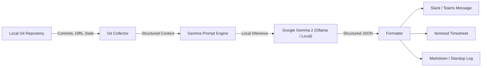

# SlothStandup 🦥

> **Channel your inner sloth.** A zero-effort, 100% private daily standup and timesheet ghostwriter powered by Google's open-weight **Gemma** model.

[](LICENSE)
[](https://dev.to/challenges/hacktoberfest-week3-2026-10-19)
[](https://platform.priorlabs.ai)
[](https://huggingface.co/google/gemma-2-2b-it)

---

## 📖 What is SlothStandup?

Tomorrow, October 20, is International Sloth Day. Sloths sleep 15 to 20 hours a day, move at their own rhythm, and conserve energy. 

Meanwhile, developers spend 20–30 minutes every morning staring blankly at Slack or Jira, agonizing over:
- *"What did I even do yesterday?"*
- *"Am I overworking or moving at a steady pace?"*
- *"How do I format this timesheet so accounting leaves me alone?"*

**SlothStandup** solves this forever. It runs quietly in the background, inspects your local `git` commits, touched branch diffs, and staged changes, combining two state-of-the-art open-source AI technologies:
1. **Prior Labs TabPFN (Tabular Foundation Model):** Analyzes tabular commit metrics (`churn`, `insertions`, `deletions`, `files_modified`) to detect overexertion anomalies, predict code review friction, and alert you if you are working too fast and risking burnout.
2. **Google Gemma 2 (Open-Weight LLM):** Synthesizes chaotic git diffs into a professional Slack/Teams standup message, itemized timesheets, and a Sloth Efficiency metric.

---

## ⚡ Key Features

* **🦥 Zero-Effort Automation:** One simple command (`sloth` or `slothstandup`) reads your commits and produces your entire update.
* **🔒 100% Private & On-Device:** Unlike closed cloud APIs (OpenAI, Claude), your private proprietary company code never leaves your laptop. Gemma runs locally.
* **💸 $0 Cost & Offline-Ready:** Works in an airplane or subway without Wi-Fi. No monthly SaaS bills or token surcharges.
* **⏱️ Timesheet Auto-Reconciliation:** Automatically maps code commits to realistic engineering, QA, and planning hours.
* **🎯 Powered by Gemma:** Engineered specifically for Google's lightweight, open-weight `gemma2:2b` and `gemma2:9b` models via Ollama or local inference.

---

## 🛠️ Architecture



---

## 🚀 Quickstart

### Installation

```bash
# Clone the repository
git clone https://github.com/Nl-T-lN/slothstandup.git
cd slothstandup

# Install dependencies
pip install -r requirements.txt
pip install -e .
```

### Requirements
- Python 3.8+
- (Optional, recommended) [Ollama](https://ollama.ai) with Gemma 2:
  ```bash
  ollama pull gemma2:2b
  ```

---

## 💻 Usage

Run in any local git directory:

```bash
# Generate full standup and timesheet for yesterday
slothstandup

# Generate only Slack-ready markdown
slothstandup --format slack

# Look back over the past 3 days
slothstandup --since "3 days ago"

# Generate timesheet table only
slothstandup --format timesheet
```

### CLI Output Preview

```text
   (\_/)  
   ( •.•)  SlothStandup 🦥
   / >🌱  v0.1.0 • Powered by Gemma (Open-Weight)

✔ Analysis complete for branch 'main' (18 + / 4 - across 3 files)

╭─────────────────────────── 💬 Slack / Teams Ready ───────────────────────────╮
│ 🦥 *Daily Standup Update*                                                    │
│                                                                              │
│ ✅ *Yesterday / Accomplished:*                                               │
│ • Delivered: Implement JWT token validation middleware                      │
│ • Delivered: Fix PostgreSQL pool connection timeout under heavy load        │
│                                                                              │
│ 🚧 *Today / In Progress:*                                                    │
│ • Continue feature rollout & integration on 'auth-v2' branch.                │
│ • Write comprehensive tests, address edge cases, and run linting.            │
│ • Prepare PR for peer review once sanity checks pass.                        │
│                                                                              │
│ ⚠️ *Blockers:*                                                                │
│ • None - clear progress.                                                     │
│                                                                              │
│ _🦥 Never type in 15 minutes what an open-weight model can synthesize in 3s._│
╰────────────── Copy & paste directly into your standup channel ───────────────╯

                        ⏱️ Automated Timesheet Breakdown                         
┏━━━━━━━━━━━━━━━━━━━━━━━━┳━━━━━━━━━━━━━━━━━━━━━━━━━━━━━━━━━━━━━━┳━━━━━━━━━━━━━━┓
┃ Category               ┃ Task Description                     ┃ Logged Hours ┃
┡━━━━━━━━━━━━━━━━━━━━━━━━╇━━━━━━━━━━━━━━━━━━━━━━━━━━━━━━━━━━━━━━╇━━━━━━━━━━━━━━┩
│ Engineering            │ Core feature implementation (auth)   │         4.5h │
│ Quality Assurance      │ Testing, debugging & local verif     │         2.0h │
│ Planning               │ Architecture planning & code review  │         1.0h │
├────────────────────────┼──────────────────────────────────────┼──────────────┤
│ Total Hours            │ Auto-reconciled                      │         7.5h │
└────────────────────────┴──────────────────────────────────────┴──────────────┘
```

---

## 🧪 Running Tests

```bash
python3 -m unittest discover tests
```

---

## 🌟 Why Open Innovation Matters

1. **Security & NDA Compliance:** Closed APIs require uploading commit diffs and code patches to external cloud servers. For private repositories, this violates company security policies and client NDAs. Gemma runs 100% offline on your hardware.
2. **Deterministic & Hackable:** Open-weight models can be quantised, fine-tuned, and adapted to custom internal ticket formats (Jira, Linear, GitHub Issues).
3. **Infinite Freedom:** No rate limits, no subscription tiers, no unexpected API deprecations.

---

## 📜 License

MIT License © 2026 Nitin Pandey
