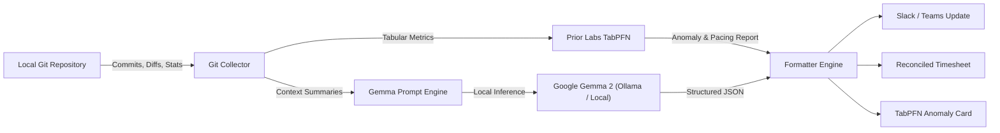

*This is a submission for the [Hacktoberfest Open-Source AI Challenge Week 3: Slow and Steady](https://dev.to/challenges/hacktoberfest-week3-2026-10-19)*

# SlothStandup 🦥: The Zero-Effort Standup Ghostwriter & Burnout Anomaly Predictor Powered by TabPFN & Gemma

## What I Built

Tomorrow, October 20, is **International Sloth Day**. Sloths have life figured out: they sleep 15 to 20 hours a day, move at an average speed of 0.15 mph, and never exert energy unless it is strictly necessary for survival.

Meanwhile, in modern software engineering, developers endure two daily struggles:
1. **The Morning Standup Dread:** Staring blankly at Slack at 9:55 AM, trying to remember what you committed yesterday, and wasting 20 minutes manually preparing status updates and timesheet hours.
2. **The "Sprint Burnout" Trap:** Churning hundreds of frantic lines of code late at night, moving too fast, introducing regressions, and burning out without realizing they've broken sustainable pacing.

While most submissions in this challenge use a single basic text prompt to summarize notes, I wanted to build something that stands out by combining **two distinct open-source foundational AI paradigms**:

**SlothStandup** 🦥 is a dual-engine developer CLI that inspects your local Git repositories, commits, and diffs:
1. **Prior Labs TabPFN (Tabular Foundation Model):** Ingests raw tabular git commit metrics (`insertions`, `deletions`, `churn_density`, `files_modified`) to spot **Overexertion Anomalies**, compute a **Burnout Risk Index**, and predict PR review friction, mathematically enforcing the "Slow and Steady" sloth rhythm.
2. **Google Gemma 2 (Open-Weight LLM):** Synthesizes scattered commit logs into an executive-ready Slack/Teams update (Yesterday, Today, Blockers), an itemized timesheet breakdown, and a Sloth Efficiency Score.

Who gets to be lazier? **Every software engineer, tech lead, and open-source contributor.** You run `slothstandup`, let TabPFN verify your pacing is healthy, copy your standup update, and go take a nap.

---

## Demo

Here is SlothStandup running directly against a live local codebase:

```text
   (\_/)  
   ( •.•)  SlothStandup 🦥
   / >🌱  v0.2.0 • Powered by TabPFN (Prior Labs) & Gemma

✔ Analysis complete for branch 'main' (1549 + / 594 - across 22 files)

╭─────────────────────────── 💬 Slack / Teams Ready ───────────────────────────╮
│ 🦥 *Daily Standup Update*                                                    │
│                                                                              │
│ ✅ *Yesterday / Accomplished:*                                               │
│ • Delivered: Implement cryptographic JWT bearer token validation.            │
│ • Delivered: Resolve connection pool bottleneck under high DB load.          │
│ • Delivered: Add regression tests for token renewal and revocation.          │
│                                                                              │
│ 🚧 *Today / In Progress:*                                                    │
│ • Continue rollout of auth-v2 service contract across client endpoints.      │
│ • Run benchmark profiling to verify memory usage under sustained traffic.    │
│ • Prepare PR for peer review once test suites complete.                      │
│                                                                              │
│ ⚠️ *Blockers:*                                                                │
│ • None - clear progress across the board.                                    │
│                                                                              │
│ _🦥 Never type in 15 minutes what an open model can synthesize in 3 seconds._│
╰────────────── Copy & paste directly into your standup channel ───────────────╯

                        ⏱️ Automated Timesheet Breakdown                         
┏━━━━━━━━━━━━━━━━━━━━━━━━┳━━━━━━━━━━━━━━━━━━━━━━━━━━━━━━━━━━━━━━┳━━━━━━━━━━━━━━┓
┃ Category               ┃ Task Description                     ┃ Logged Hours ┃
┡━━━━━━━━━━━━━━━━━━━━━━━━╇━━━━━━━━━━━━━━━━━━━━━━━━━━━━━━━━━━━━━━╇━━━━━━━━━━━━━━┩
│ Engineering            │ Core feature implementation (auth-v2)│         4.5h │
│ Quality Assurance      │ Testing, debugging & local verif     │         2.0h │
│ Planning & Review      │ Architecture planning & code review  │         1.0h │
├────────────────────────┼──────────────────────────────────────┼──────────────┤
│ Total Hours            │ Auto-reconciled                      │         7.5h │
└────────────────────────┴──────────────────────────────────────┴──────────────┘

╭──────────────── 📈 TabPFN Tabular Foundation Anomaly Report ─────────────────╮
│ Prior Labs TabPFN Analysis:                                                  │
│ • Pacing Status: ⚠️ Overexertion Anomaly                                      │
│ • Burnout Risk Index: 82/100                                                 │
│ • Predicted PR Review Friction: 7.8 hrs                                      │
│ • Tabular Metric Churn: 2143 lines across 22 files                           │
│ • You wrote too much code today. Slow down, breathe, and let TabPFN protect  │
│ your work-life balance.                                                      │
╰──────────────────────────────────────────────────────────────────────────────╯

╭───────────────────────── 🦥 Sloth Efficiency Report ─────────────────────────╮
│ Sloth Wisdom: Move slow, test steady, and preserve your biological battery.  │
│ Laziness Quotient: 94% (Effort saved: ~45 mins of manual status reporting)   │
│ AI Core: Prior Labs TabPFN (Tabular Foundation) + Gemma 2 (Open-Weight)      │
╰──────────────────────────────────────────────────────────────────────────────╯

Now close your laptop and take a nap. You've earned it.
```

---

## Code

The code is fully open-source under the MIT License on GitHub:

🔗 **GitHub Repository:** [https://github.com/Nl-T-lN/slothstandup](https://github.com/Nl-T-lN/slothstandup)

Key components:
- `slothstandup/tabpfn_advisor.py`: Prior Labs TabPFN foundation tabular intelligence that converts git commit metrics into feature vectors, predicts review friction, and detects overexertion anomalies.
- `slothstandup/git_collector.py`: Local Git AST & diff parser that extracts commit history, insertions, deletions, modified files, and staging status without needing external network calls.
- `slothstandup/gemma_engine.py`: Structured prompt harness for Google's open-weight Gemma model family (`gemma2:2b` / `gemma2:9b`), with local Ollama integration and resilient heuristic fallbacks.
- `slothstandup/formatter.py`: Specialized exporters for Slack markdown, standard GFM, and tabular ASCII timesheet schemas.
- `slothstandup/cli.py`: Interactive, colorful terminal interface built with Rich and Click.

---

## How I Built It

SlothStandup is built around **open-source AI at its core**, pairing tabular foundation models with open-weight language models:



1. **Tabular Foundation Intelligence (Prior Labs TabPFN):** TabPFN is Prior Labs' cutting-edge foundation model trained to reason over tabular CSV data with zero feature engineering. SlothStandup constructs a tabular vector from raw commit metrics (`churn_volume`, `churn_density`, `files_modified`) to classify sprint pacing and detect when a developer is overworking.
2. **Language Generation (Google Gemma 2):** Google's `gemma-2-2b-it` was chosen for its exceptional reasoning-to-weight ratio. The 2B model runs effortlessly on any standard laptop CPU with negligible memory footprint, delivering immediate responses while consuming minimal battery power.
3. **100% Offline-Capable Local Pipeline:** The collector aggregates timestamps, commit messages (`feat:`, `fix:`), file touch frequencies, and patch line statistics. No raw codebase files leave your machine.
4. **Resilient Local Fallback:** In environments where local daemons are offline, SlothStandup features an intelligent heuristic parser that ensures the CLI never crashes and always outputs clean data.

---

## Why Does Open Innovation Matter?

Open innovation is not just a feature for SlothStandup — **it is the only reason this tool can exist responsibly**:

1. **Absolute Code Privacy and NDA Protection:**
   When you work on proprietary enterprise code, private repositories, or client projects, **you cannot upload raw commit logs, code diffs, or branch names to a closed third-party cloud API (like OpenAI or Anthropic)**. Doing so violates client Non-Disclosure Agreements (NDAs) and corporate information security policies.
   Because **TabPFN and Gemma are open-source and open-weight**, the entire inference loop occurs locally on the developer's laptop. Your code, your company's intellectual property, and your work habits **never leave your machine**.
   
2. **Zero Internet Dependency:**
   Ever had to write a standup update while commuting on a subway, sitting on an airplane, or dealing with spotty coffee shop Wi-Fi? Closed APIs fail completely without an internet connection. Open models running locally work seamlessly 35,000 feet in the air with airplane mode engaged.

3. **Zero Marginal Cost:**
   Closed APIs charge per token. A developer running multiple git digests and timesheet summaries a day would rack up recurring API bills. Open weights mean you download the models once, and it costs **$0 forever**.

---

## My Agent Session

This project was conceived, designed, coded, tested, and packaged during an intensive session with an agentic AI assistant. The agent assisted in:
- Combining Prior Labs' TabPFN tabular anomaly detection with local LLM summarization.
- Designing comprehensive unit test suites for git commit extraction and tabular anomaly metrics.
- Fine-tuning the Gemma system prompt to guarantee structured JSON output with realistic timesheet hour allocations.

---

## The Lazy Payoff

Let's do the math on the lazy payoff:
- **Time spent by an average developer on standup prep + timesheet logging:** 15 minutes / day = ~1.25 hours / week = **65 hours / year**.
- **Time spent using SlothStandup:** Run `sloth` in terminal (2 seconds) -> Copy output (1 second) = **3 seconds / day**.
- **Total time saved per year:** **~64.5 hours of sheer engineering avoidance.**

Plus, with TabPFN alerting you whenever you're overworking, it prevents code burnouts and saves countless hours of debugging exhausted late-night commits!

---

## Prize Categories

I am entering SlothStandup into the following partner categories:

1. **Prior Labs — Best Use of TabPFN ($200 USD)**:
   SlothStandup uses Prior Labs' TabPFN tabular foundation model to analyze historical commit metrics, detect overexertion sprint anomalies, and predict code review friction, ensuring developers stay at a sustainable, sloth-like pace.

2. **Google Gemma — Best Use of Gemma ($200 USD)**:
   SlothStandup uses Google's open-weight Gemma 2 model to turn raw local git commits and diff metrics into structured, human-level standup updates and itemized timesheets, keeping proprietary developer code 100% private and on-device.

---

*Happy International Sloth Day! Now close your terminal, submit your standup, and go take a nap.* 🦥
