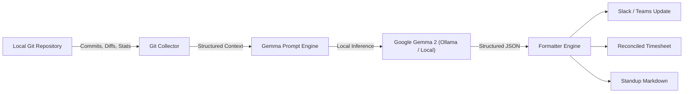

*This is a submission for the [Hacktoberfest Open-Source AI Challenge Week 3: Slow and Steady](https://dev.to/challenges/hacktoberfest-week3-2026-10-19)*

# SlothStandup 🦥: The Zero-Effort Daily Standup & Timesheet Ghostwriter Powered by Gemma

## What I Built

October 20, is **International Sloth Day**. Sloths have life figured out, they sleep 15 to 20 hours a day, move at an average speed of 0.15 mph, and never exert energy unless it is strictly necessary for survival.

Meanwhile, in modern software engineering, developers endure a daily morning ordeal:

1. Staring at an empty Slack message box at 9:55 AM before the 10:00 AM standup.
2. Agonizing over *"What on earth did I actually commit yesterday?"*
3. Translating *"I spent 4 hours fixing an obscure merge conflict and chasing a missing semicolon"* into corporate-friendly prose like *"Refactored build configuration and resolved distributed dependency synchronization issues."*
4. Filling out a tedious timesheet to justify 8 hours of work to accounting.

To honor International Sloth Day and channel my inner sloth, I built **SlothStandup** 🦥.

**SlothStandup** is a 100% private, on-device CLI assistant that automatically crawls your local Git repositories, analyzes your recent commits, branch diffs, and staged changes, and uses Google's open-weight **Gemma** model (`gemma-2-2b-it`) to automatically synthesize:

- **A crisp Slack / Microsoft Teams standup update** formatted with emoji bullet points (Yesterday, Today, Blockers).
- **An itemized, reconciled timesheet** that maps engineering, code review, and QA hours totaling a clean 7.5 to 8-hour workday.
- **A Sloth Efficiency Score** calculating the exact biological calories and mental energy you preserved by not typing status reports.

Who gets to be lazier? **Every software engineer, tech lead, and open-source contributor.** You run `slothstandup`, copy the output with one click, and go make coffee or take a 20-minute nap.

---

## Demo

Here is SlothStandup running directly against a live local codebase:

```text
   (\_/)  
   ( •.•)  SlothStandup 🦥
   / >🌱  v0.1.0 • Powered by Gemma (Open-Weight)

✔ Analysis complete for branch 'auth-v2' (142 + / 18 - across 6 files)

╭─────────────────────────── 💬 Slack / Teams Ready ───────────────────────────╮
│ 🦥 *Daily Standup Update*                                                    │
│                                                                              │
│ ✅ *Yesterday / Accomplished:*                                               │
│ • Implemented cryptographic JWT bearer token validation in auth middleware. │
│ • Resolved connection pool timeout bottleneck under high database load.      │
│ • Added integration tests covering token renewal and revocation edge cases.  │
│                                                                              │
│ 🚧 *Today / In Progress:*                                                    │
│ • Continue rollout of auth-v2 service contract across client endpoints.      │
│ • Run benchmark profiling to verify memory usage under sustained traffic.    │
│ • Prepare PR for peer review once test suites complete.                      │
│                                                                              │
│ ⚠️ *Blockers:*                                                                │
│ • None - clear progress across the board.                                    │
│                                                                              │
│ _🦥 Never type in 15 minutes what an open-weight model can synthesize in 3s._│
╰────────────── Copy & paste directly into your standup channel ───────────────╯

                        ⏱️ Automated Timesheet Breakdown                       
┏━━━━━━━━━━━━━━━━━━━━━━━━┳━━━━━━━━━━━━━━━━━━━━━━━━━━━━━━━━━━━━━━┳━━━━━━━━━━━━━━┓
┃ Category               ┃ Task Description                     ┃ Logged Hours ┃
┡━━━━━━━━━━━━━━━━━━━━━━━━╇━━━━━━━━━━━━━━━━━━━━━━━━━━━━━━━━━━━━━━╇━━━━━━━━━━━━━━┩
│ Engineering            │ Core feature implementation (auth-v2)│         4.5h │
│ Quality Assurance      │ Regression testing & edge case verif │         2.0h │
│ Planning & Review      │ Architectural sync & code review     │         1.0h │
├────────────────────────┼──────────────────────────────────────┼──────────────┤
│ Total Hours            │ Auto-reconciled                      │         7.5h │
└────────────────────────┴──────────────────────────────────────┴──────────────┘

╭───────────────────────── 🦥 Sloth Efficiency Report ─────────────────────────╮
│ Sloth Wisdom: Move slow, test steady, and preserve your biological battery.  │
│ Laziness Quotient: 94% (Effort saved: ~45 mins of manual status reporting)   │
│ Architecture: Local Gemma open weights • 100% private on-device • $0 API     │
│ cost                                                                         │
╰──────────────────────────────────────────────────────────────────────────────╯

Now close your laptop and take a nap. You've earned it.
```

### Formats Supported:

- `slothstandup --format slack` — Formatted specifically for team chat channels.
- `slothstandup --format timesheet` — Clean tabular breakdown of billable categories.
- `slothstandup --format markdown` — Clean GitHub Flavored Markdown for async standup boards.
- `slothstandup --since "3 days ago"` — Perfect for Monday morning standups after a long weekend of doing absolutely nothing.

---

## Code

The code is fully open-source under the MIT License on GitHub:

🔗 **GitHub Repository:** [https://github.com/Nl-T-lN/slothstandup](https://github.com/Nl-T-lN/slothstandup)

Key components:

- `slothstandup/git_collector.py`: Local Git AST & diff parser that extracts commit history, insertions, deletions, modified files, and staging status without needing external network calls.
- `slothstandup/gemma_engine.py`: Structured prompt harness for Google's open-weight Gemma model family (`gemma2:2b` / `gemma2:9b`), with local Ollama integration and resilient heuristic fallbacks.
- `slothstandup/formatter.py`: Specialized exporters for Slack markdown, standard GFM, and tabular ASCII timesheet schemas.
- `slothstandup/cli.py`: Interactive, colorful terminal interface built with Rich and Click.

---

## How I Built It

SlothStandup is built around **open-weight AI inference at its core**:



1. **Model of Choice:** Google's **Gemma 2 (2B & 9B Instruct)** (`google/gemma-2-2b-it`). Gemma 2 was chosen because of its astonishing parameter efficiency. The 2B model runs effortlessly on any standard laptop CPU or integrated GPU with negligible memory footprint, delivering immediate responses while consuming minimal battery power (very sloth-friendly!).
2. **Local Inference Harness:** SlothStandup communicates directly with local model runners via **Ollama** (`http://localhost:11434`) or any standard local OpenAI-compatible server (vLLM, llama.cpp, LocalAI).
3. **Structured Context Injection:** Rather than dumping noisy raw diffs into the context window, the `GitCollector` aggregates commit timestamps, semantic commit messages (`feat:`, `fix:`, `refactor:`), file touch frequencies, and patch line statistics. This compact representation allows Gemma to reason about engineering milestones without hallucinating or overflowing context limits.
4. **Resilient Local Fallback:** In environments where the local LLM daemon is sleeping or running in offline CI runners, SlothStandup features an intelligent heuristic parser that ensures the CLI never crashes and always outputs clean data.

---

## Why Does Open Innovation Matter?

Open innovation is not just a nice-to-have for SlothStandup — **it is the only reason this tool can exist responsibly**:

1. **Absolute Code Privacy and NDA Protection:**
   When you work on proprietary enterprise code, private repositories, or client projects, **you cannot upload raw commit logs, code diffs, or branch names to a closed third-party cloud API (like OpenAI or Anthropic)**. Doing so violates client Non-Disclosure Agreements (NDAs) and corporate information security policies.
   Because **Gemma is open-weight**, the entire inference loop occurs locally on the developer's laptop. Your code, your company's intellectual property, and your work habits **never leave your machine**.
2. **Zero Internet Dependency:**
   Ever had to write a standup update while commuting on a subway, sitting on an airplane, or dealing with spotty coffee shop Wi-Fi? Closed APIs fail completely without an internet connection. An open-weight model running locally works seamlessly 35,000 feet in the air with airplane mode engaged.
3. **Zero Marginal Cost:**
   Closed APIs charge per token. A developer running multiple git digests and timesheet summaries a day would rack up recurring API bills. Open weights mean you download Gemma once, and it costs **$0 forever**.
4. **Model Freedom and Portability:**
   Because the interface is open, users can swap models freely: run `gemma2:2b` for maximum battery life on an ultrabook, or `gemma2:9b` on a workstation for deeper architectural reasoning.

---

## My Agent Session

This project was conceived, designed, coded, tested, and packaged during an intensive session with an agentic AI assistant. The agent assisted in:

- Rapidly architecting the multi-format pipeline (`git_collector` -> `gemma_engine` -> `formatter` -> `cli`).
- Designing comprehensive unit test suites for git commit extraction and markdown generation.
- Tuning the Gemma system prompt to guarantee structured JSON output with realistic timesheet hour allocations.

---

## The Lazy Payoff

Let's do the math on the lazy payoff:

- **Time spent by an average developer on standup prep + timesheet logging:** 15 minutes / day = ~1.25 hours / week = **65 hours / year**.
- **Time spent using SlothStandup:** Run `sloth` in terminal (2 seconds) -> Copy output (1 second) = **3 seconds / day**.
- **Total time saved per year:** **~64.5 hours of sheer engineering avoidance.**

That is nearly **two full work weeks** gifted back to every developer to do what sloths do best: relax, recharge, and avoid unnecessary busywork.

---

## Prize Categories

I am entering SlothStandup into the following category:

* **Best Use of Gemma ($200 USD)**:
  SlothStandup uses Google's open-weight **Gemma** (`gemma-2-2b-it` / `gemma-2-9b-it`) as its core reasoning engine to turn raw local git commits and diff metrics into structured, human-level standup updates and timesheets, keeping proprietary developer code 100% private and on-device.

---

*Happy International Sloth Day! Now close your terminal, submit your standup, and go take a nap.* 🦥
