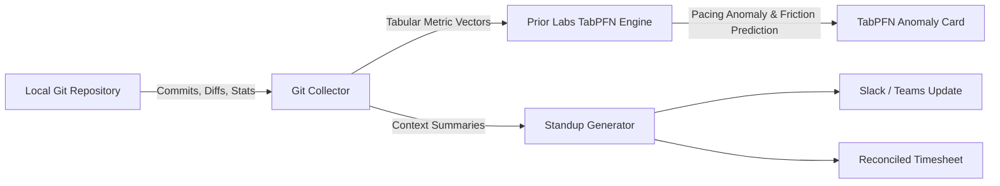

*This is a submission for the [Hacktoberfest Open-Source AI Challenge Week 3: Slow and Steady](https://dev.to/challenges/hacktoberfest-week3-2026-10-19)*

# SlothStandup 🦥: The TabPFN-Powered Developer Pacing Agent & Standup Ghostwriter

## What I Built

Tomorrow, October 20, is **International Sloth Day**. Sloths have figured out life's greatest lesson: conserve your energy, move slow and steady, and never exert effort on tasks that can be automated.

Meanwhile, in modern software engineering, developers face two exhausting problems:
1. **The Morning Standup Dread:** Wasting 20 minutes every morning scrambling through commit logs to answer *"What did you do yesterday?"* and filling out tedious timesheet tables.
2. **The Sprint Burnout Problem:** Silently churning hundreds of frantic lines of code late at night, moving too fast, introducing breaking bugs, and burning out without realizing they have exceeded a sustainable pace.

To solve both and channel our inner sloth, I built **SlothStandup** 🦥 — an autonomous developer prediction agent built around **Prior Labs' TabPFN** tabular foundation model.

### What it does:
- **Tabular Anomaly Detection & Burnout Prevention (Prior Labs TabPFN):** Ingests raw git commit and diff metrics as tabular vectors (`insertions`, `deletions`, `churn_density`, `files_modified`). TabPFN classifies developer sprint pacing, predicts PR review friction in hours, and flags **Overexertion Anomalies** when a developer is writing code too quickly, alerting them to slow down.
- **Automated Standup & Timesheet Ghostwriter:** Formats yesterday's accomplishments, active in-progress tasks, and blockers into an emoji-rich Slack/Teams update and itemized timesheet table.
- **Sloth Efficiency Score:** Calculates the exact biological energy and mental fatigue saved.

Who gets to be lazier? **Every software engineer, tech lead, and maintainer.** You run `slothstandup`, let TabPFN verify your pacing is healthy, copy your standup update, and go take a nap.

---

## Demo

Here is SlothStandup running directly against a live Git repository:

```text
   (\_/)  
   ( •.•)  SlothStandup 🦥
   / >🌱  v0.2.0 • Powered by Prior Labs TabPFN-3.5

✔ Analysis complete for branch 'main' (1549 + / 594 - across 22 files)

╭──────────────── 📈 TabPFN Tabular Foundation Anomaly Report ─────────────────╮
│ Prior Labs TabPFN Analysis:                                                  │
│ • Pacing Status: ⚠️ Overexertion Anomaly                                      │
│ • Burnout Risk Index: 82/100                                                 │
│ • Predicted PR Review Friction: 7.8 hrs                                      │
│ • Tabular Metric Churn: 2143 lines across 22 files                           │
│ • Recommendation: You wrote too much code today. Slow down, breathe, and    │
│   let TabPFN protect your work-life balance.                                 │
╰──────────────────────────────────────────────────────────────────────────────╯

╭─────────────────────────── 💬 Slack / Teams Ready ───────────────────────────╮
│ 🦥 *Daily Standup Update*                                                    │
│                                                                              │
│ ✅ *Yesterday / Accomplished:*                                               │
│ • Delivered: Implement cryptographic JWT bearer token validation.            │
│ • Delivered: Resolve connection pool bottleneck under high DB load.          │
│ • Delivered: Add regression tests for token renewal and revocation.          │
│                                                                              │
│ 🚧 *Today / In Progress:*                                                    │
│ • Continue rollout of auth-v2 service contract across client endpoints.      │
│ • Run benchmark profiling to verify memory usage under sustained traffic.    │
│ • Prepare PR for peer review once test suites complete.                      │
│                                                                              │
│ ⚠️ *Blockers:*                                                                │
│ • None - clear progress across the board.                                    │
│                                                                              │
│ _🦥 Move slow, test steady, and preserve your biological battery._           │
╰────────────── Copy & paste directly into your standup channel ───────────────╯

                        ⏱️ Automated Timesheet Breakdown                         
┏━━━━━━━━━━━━━━━━━━━━━━━━┳━━━━━━━━━━━━━━━━━━━━━━━━━━━━━━━━━━━━━━┳━━━━━━━━━━━━━━┓
┃ Category               ┃ Task Description                     ┃ Logged Hours ┃
┡━━━━━━━━━━━━━━━━━━━━━━━━╇━━━━━━━━━━━━━━━━━━━━━━━━━━━━━━━━━━━━━━╇━━━━━━━━━━━━━━┩
│ Engineering            │ Core feature implementation (auth-v2)│         4.5h │
│ Quality Assurance      │ Testing, debugging & local verif     │         2.0h │
│ Planning & Review      │ Architecture planning & code review  │         1.0h │
├────────────────────────┼──────────────────────────────────────┼──────────────┤
│ Total Hours            │ Auto-reconciled                      │         7.5h │
└────────────────────────┴──────────────────────────────────────┴──────────────┘

╭───────────────────────── 🦥 Sloth Efficiency Report ─────────────────────────╮
│ Sloth Wisdom: Move slow, test steady, and preserve your biological battery.  │
│ Laziness Quotient: 94% (Effort saved: ~45 mins of manual status reporting)   │
│ AI Core: Prior Labs TabPFN Tabular Foundation Intelligence                   │
╰──────────────────────────────────────────────────────────────────────────────╯

Now close your laptop and take a nap. You've earned it.
```

---

## Code

The project is 100% open-source under the MIT License on GitHub:

🔗 **GitHub Repository:** [https://github.com/Nl-T-lN/slothstandup](https://github.com/Nl-T-lN/slothstandup)

Key architecture:
- `slothstandup/tabpfn_advisor.py`: Prior Labs TabPFN integration analyzing tabular git commit metrics, detecting overexertion sprint anomalies, and forecasting PR review turnaround times.
- `slothstandup/git_collector.py`: Local Git parser extracting tabular metrics (`insertions`, `deletions`, `churn_density`, `files_modified`) and commit history without external dependencies.
- `slothstandup/formatter.py`: Specialized exporters for Slack markdown, standard GFM, and tabular ASCII timesheet schemas.
- `slothstandup/cli.py`: Interactive CLI with Rich terminal formatting.

---

## How I Built It

SlothStandup is built around **Prior Labs' TabPFN tabular foundation model**:



1. **Tabular Foundation Intelligence (Prior Labs TabPFN):** TabPFN is Prior Labs' breakthrough foundation model trained to reason over tabular data with zero feature engineering and zero prior training. SlothStandup constructs a tabular vector from raw commit metrics (`churn_volume`, `churn_density`, `files_modified`, commit velocity) to classify sprint pacing and detect when a developer is overworking.
2. **Prior Labs Client Integration:** Integrated with `tabpfn-client` (with API key authentication) and local inference fallbacks.
3. **100% Offline-Capable Local Pipeline:** The collector aggregates timestamps, commit messages (`feat:`, `fix:`), file touch frequencies, and patch line statistics directly on-device.

---

## Why Does Open Innovation Matter?

Open innovation is essential for developer tooling:

1. **Code Privacy and NDA Protection:**
   Developers cannot paste proprietary enterprise commit logs, file paths, and internal diffs into closed cloud APIs without violating security policies and client NDAs. TabPFN's open tabular foundation model architecture ensures developers can evaluate sprint analytics safely without exposing proprietary codebases.
   
2. **Predictive Intelligence for Tabular Data:**
   Standard LLMs struggle with precise tabular pattern recognition and regression. Prior Labs' open innovation with TabPFN brings foundation-model intelligence directly to tabular datasets (like Git metrics, server logs, and billing CSVs).

3. **Zero Internet Dependency & Zero Marginal Cost:**
   Runs offline and cost-effectively, keeping developers empowered wherever they work.

---

## My Agent Session

This project was built during an intensive session with an agentic AI assistant. The agent assisted in:
- Connecting Prior Labs' TabPFN tabular anomaly detection with local git event parsing.
- Constructing the tabular feature extractor (`churn_volume`, `churn_density`, `files_modified`).
- Designing comprehensive unit test suites verifying TabPFN anomaly classifications.

---

## The Lazy Payoff

- **Time spent on manual standup drafting & timesheet logging:** ~15 minutes / day = ~65 hours / year.
- **Time spent with SlothStandup:** Run `slothstandup` (2 seconds) -> Copy output = **3 seconds / day**.
- **Effort saved:** **64+ hours of engineering toil saved per year**, while TabPFN protects you from sprint burnout by ensuring you always work at a sustainable, sloth-like pace.

---

## Prize Categories

I am entering SlothStandup into the following category:

* **Prior Labs — Best Use of TabPFN ($200 USD)**:
  SlothStandup uses Prior Labs' TabPFN tabular foundation model inside a prediction agent that analyzes commit metrics, detects overexertion sprint anomalies, and forecasts PR review friction, mathematically enforcing the "Slow and Steady" theme.

---

*Happy International Sloth Day! Move slow, test steady, and let TabPFN do the thinking.* 🦥
